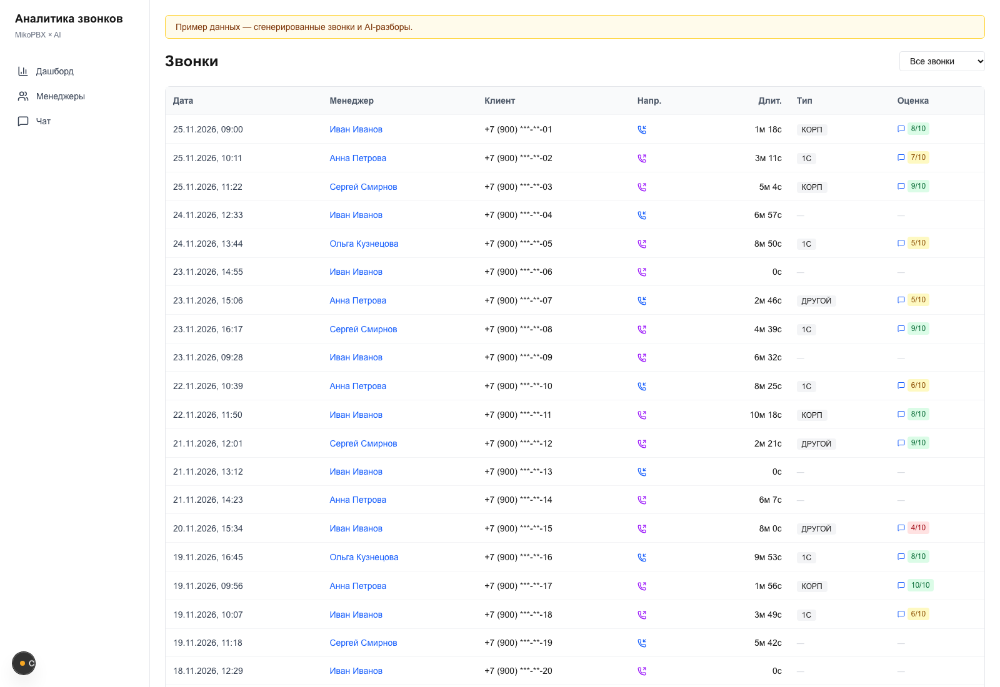
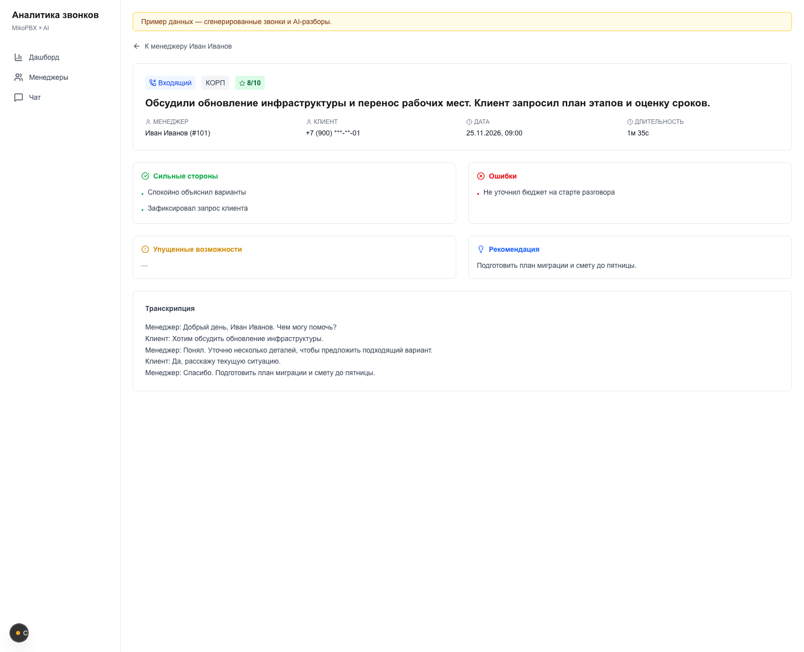

# MikoPBX Call Analytics

Набор для анализа звонков MikoPBX: n8n получает и обрабатывает звонки, а веб-дашборд показывает статистику по менеджерам и результаты AI-разбора.

> **Демо-данные.** Скриншоты и демонстрационный режим используют синтетические звонки и вымышленные имена. Реальные записи, расшифровки и персональные данные в репозитории не публикуются.

## Скриншоты

### Список звонков



### Пример карточки AI-разбора



## Состав проекта

- [`dashboard/`](dashboard/) — Next.js-интерфейс: сводка, список звонков, менеджеры и карточка разбора.
- [`n8n/mikopbx-call-analytics/`](n8n/mikopbx-call-analytics/) — основной workflow для обработки записи, транскрибации, анализа и передачи результата.
- [`n8n/mikopbx-manager-launcher/`](n8n/mikopbx-manager-launcher/) — workflow запуска анализа по списку менеджеров.

Дашборд читает данные из Supabase. Сам по себе он не запускает workflow: n8n и приложение связаны через базу данных.

## Запуск демо-дашборда

Требуется Node.js и npm.

```bash
cd dashboard
cp .env.example .env.local
npm ci
npm run dev
```

Откройте [http://localhost:3000](http://localhost:3000). Флаг `NEXT_PUBLIC_DEMO_MODE=true` включает синтетические данные из `src/lib/demo-data.ts`; для обычного режима укажите URL и публичный anon key своего Supabase-проекта и задайте `NEXT_PUBLIC_DEMO_MODE=false`.

Не добавляйте `.env.local`, рабочие credentials, URL внутренних систем, записи звонков или реальные расшифровки в Git.

## Импорт n8n workflows

Опубликованные `workflow.json` — обезличенные структурные схемы: в них сохранены узлы и связи, но параметры узлов удалены. Они показывают состав автоматизации и не являются готовыми к запуску экспортами. Для рабочего запуска нужно восстановить логику параметров в своей среде n8n, задать credentials и внутренние идентификаторы; перед запуском проверить каждый узел и маршрут данных.

Подробности и ограничения указаны в README рядом с каждым workflow.
